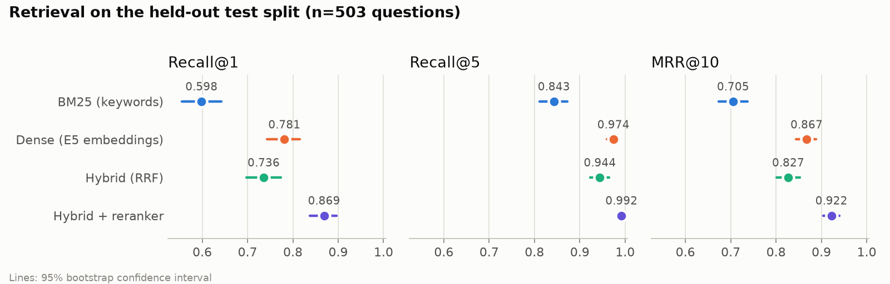
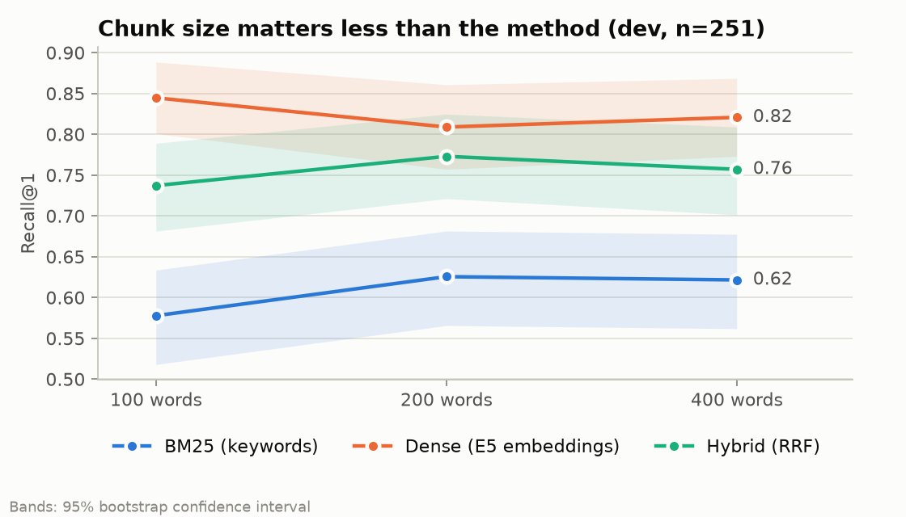

# govqa: question answering over Dutch government pages, with the numbers to back it up

A retrieval-augmented assistant that answers citizens' questions from the official
question-and-answer pages of [Rijksoverheid.nl](https://www.rijksoverheid.nl) (licence CC0), and
an evaluation harness that measures how well each part of it works.

The assistant is the smaller half of this project. The larger half is the evaluation: every
design choice below was made from a measurement on held-out questions, with confidence intervals,
and one of my own assumptions turned out to be wrong.

> Portfolio project by Gabriel Jukema. Not an official government service.

## Results in short

Retrieval, 503 held-out real citizen questions, 1,258 pages in the index:



| Method | Recall@1 | Recall@5 | MRR@10 | Search time per query |
|---|---|---|---|---|
| BM25 (keywords) | 0.598 | 0.843 | 0.705 | 4 ms |
| Dense (multilingual E5-small) | 0.781 | 0.974 | 0.867 | 0.3 ms + query embedding |
| Hybrid (BM25 + dense, RRF) | 0.736 | 0.944 | 0.827 | 6 ms |
| Hybrid + cross-encoder reranker | **0.869** | **0.992** | **0.922** | 2,300 ms |

Full tables with 95% confidence intervals: [results/RESULTS.md](results/RESULTS.md).
Timings are from a laptop CPU, no GPU, and are indicative only.

What the numbers say:

1. **Hybrid search made things worse, not better.** I expected BM25 + embeddings to beat
   embeddings alone, because that is the standard advice. Here it lost 4.5 points of Recall@1.
   BM25 is much weaker than the dense model on this data, and equal-weight rank fusion lets the
   weak ranker drag down the strong one.
2. **The reranker is the best retriever, and the difference is real.** +8.7 points Recall@1 over
   dense (paired bootstrap 95% CI +5.8 to +12.1). It also costs about 2.3 seconds per query on
   CPU.
3. **The served default is dense-only.** The language model receives the top 5 passages, so the
   metric that matters for answer quality is Recall@5: 97.4% for dense against 99.2% with the
   reranker. I judged 1.8 points not worth 2.3 seconds of extra waiting. The reranker stays
   available as an option in the API and UI.
4. **Chunk size matters less than the method.** 100, 200 and 400-word chunks gave overlapping
   confidence intervals on the dev split. I kept 200 words, which always fits inside the
   embedding model's 512-token window.



### Generation quality: not measured yet

The generation evaluation (faithfulness, correctness, citation accuracy, refusal behaviour, cost
and latency per answer) is implemented and unit-tested against a mocked provider, but it has
**not been run against a real model**, because that needs a paid API key. There are no generation
numbers in this README for that reason. To produce them:

```bash
cp .env.example .env        # set LLM_MODEL and the matching API key
uv run python -m evals.run_generation --n 150
uv run python -m evals.judge --export 40     # then label 40 answers by hand
uv run python -m evals.judge --agreement     # Cohen's kappa: LLM judge vs human
uv run python -m evals.report
```

## How it works

```
 rijksoverheid.nl ──► ingest ──► docs.parquet ──► chunk ──► index (BM25 + E5 embeddings)
   (sitemap, CC0)     polite,     1,258 pages     ≤200       │
                      cached                      words      ▼
                                              question ──► retrieve ──► top-5 passages
                                                                            │
                                                             LLM (any provider via LiteLLM)
                                                                            ▼
                                                    answer with [n] citations, or a refusal
```

- **Data.** Each page title is a question a citizen actually asks ("Mag ik mijn kind 2
  achternamen geven?") and the page body is the official answer. 1,258 pages across 178 topics,
  median 243 words.
- **Retrieval.** BM25, dense, hybrid and hybrid + reranker behind one `Retriever.search()`.
  Vectors live in a NumPy file; at this size a vector database would add nothing.
- **Generation.** A Dutch system prompt that allows only the numbered sources, requires a
  citation after each claim, and requires an explicit refusal tag when the sources do not cover
  the question. Without an API key the app runs in retrieval-only mode and shows the passages.
- **Serving.** FastAPI (`/ask`, `/health`, Prometheus `/metrics` with latency histogram, refusal
  count and cumulative LLM cost) and a Streamlit UI.

## How the evaluation is set up

- **Free, real labels.** Page titles are used as queries and the page is the correct answer.
  That gives hundreds of labelled, human-written questions without any hand-labelling.
- **No leakage.** The title is never indexed. I also found that every page ends with a
  "Meer informatie" block listing the titles of *other* questions; left in, that puts the test
  queries of other pages into a page's text. The parser strips it and a unit test guards it.
  Removing it raised BM25 Recall@1 on the dev split from 0.51 to 0.63.
- **Dev/test discipline.** 251 dev questions for choosing the configuration, 503 test questions
  touched once for the final table. Splits are seeded and disjoint.
- **Uncertainty.** Every metric has a bootstrap 95% CI, and method comparisons use a paired
  bootstrap on the same questions, so "better" means the interval excludes zero.
- **Regression gate.** `python -m evals.gate` re-runs BM25 retrieval on a committed 200-page
  sample and fails CI when Recall@5 or MRR drops more than 0.02 below the stored baseline. It
  needs no model download and no key.

## Limitations

- **The test questions are easier than real traffic.** Titles are written by communications
  staff: well-formed, same vocabulary as the answer. Real users type "paspoort kwijt wat nu".
  `evals/build_testset.py --paraphrase N` rewrites test questions into informal ones with an LLM
  so retrieval can be re-measured on harder queries; it needs a key and has not been run.
- **One relevant page per question** is assumed. Several pages often answer the same question
  (the paspoort pages overlap heavily), so Recall@1 understates real usefulness.
- **The corpus may be incomplete.** The site started refusing requests during the crawl, and the
  crawler stops when that happens instead of working around it. 1,258 pages were collected; I
  have not confirmed that this is every Q&A page. `python -m govqa.ingest` resumes where it left
  off.
- **Dutch only**, and government answers change. Pages carry a modification date, but nothing
  re-crawls automatically.
- **Hybrid was only tried with equal weights.** Weighted fusion might recover the loss; that is
  the next experiment.

## Run it

Requires [uv](https://docs.astral.sh/uv/). Python 3.12 is installed automatically.

```bash
uv sync
uv run pytest                                   # 42 tests
uv run python -m evals.gate                     # CI quality gate on the sample
```

Full pipeline (crawl ≈ 15 min, indexing ≈ 5 min on CPU):

```bash
uv run python -m govqa.ingest
uv run python -m evals.build_testset
uv run python -m govqa.index --chunk-words 100 200 400
uv run python -m evals.run_retrieval --split dev --chunk-words 100 200 400 \
    --methods bm25 dense hybrid hybrid_rerank --rerank-chunk-words 200
uv run python -m evals.run_retrieval --split test --chunk-words 200 \
    --methods bm25 dense hybrid hybrid_rerank
uv run python -m evals.report
```

Serve it:

```bash
uv run uvicorn govqa.api:app --port 8000
uv run streamlit run app/streamlit_app.py
```

or with Docker (serves the committed sample with BM25 if no full index has been built):

```bash
docker compose up --build      # API on :8000, UI on :8501
```

## Repository layout

```
src/govqa/   ingest, chunk, index, retrieve, generate, llm, metrics, api, config
evals/       build_testset, run_retrieval, run_generation, judge, gate, report
app/         Streamlit UI
tests/       unit tests (chunking, metrics, retrieval, generation with mocked LLM, API, parser)
data/sample/ 200 pages, committed so tests and CI run offline
results/     result files and charts produced by the eval scripts
```

## Stack

Python 3.12 · uv · sentence-transformers · rank-bm25 · LiteLLM · FastAPI · Streamlit ·
Prometheus client · pytest · ruff · Docker · GitHub Actions
